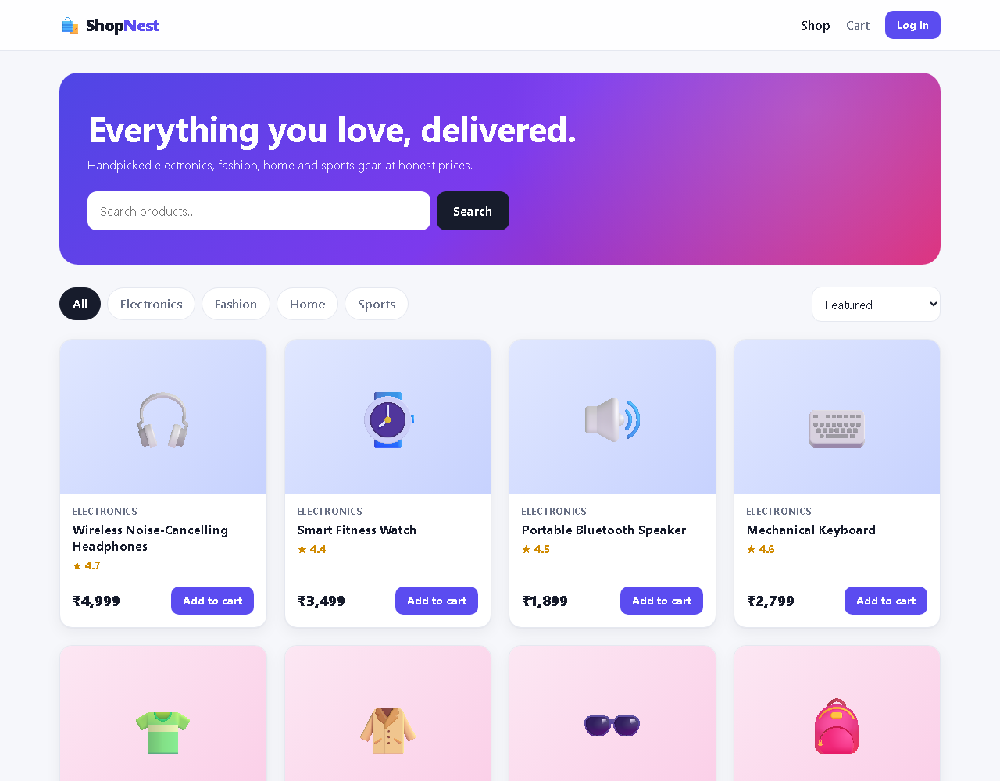
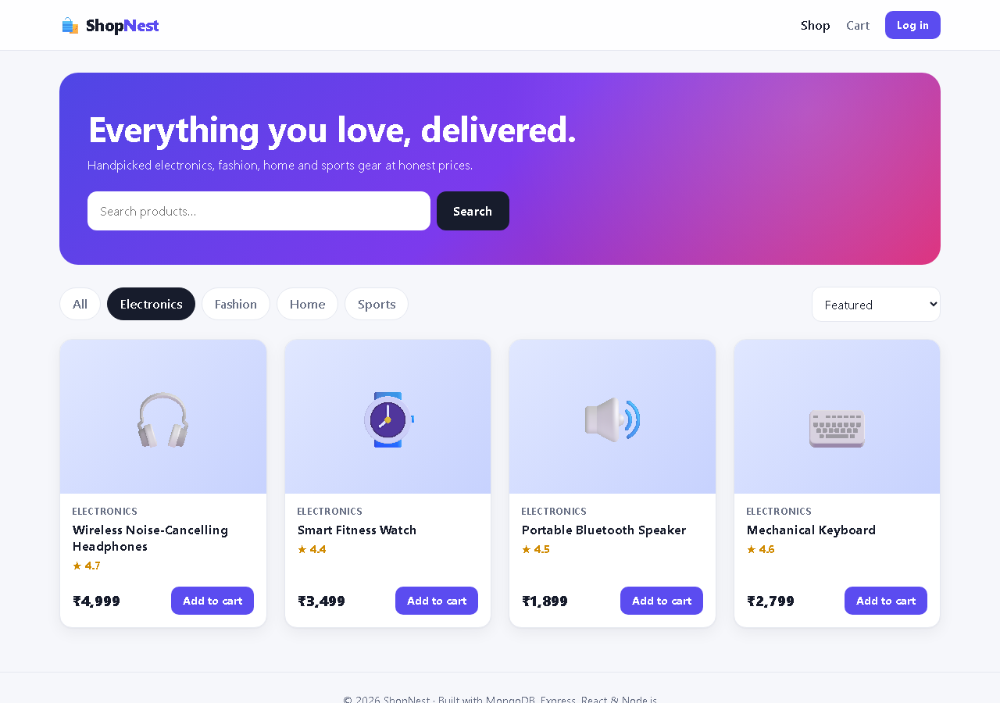

# ShopNest on Kubernetes (Minikube): Deployment Report

Project: **ShopNest**, a MERN (MongoDB, Express, React, Node.js) e-commerce store.
Source code: https://github.com/shaikmansur122/ecom_mern

## Deliverables

| Deliverable | Where |
|---|---|
| Dockerfile | [`Dockerfile`](../Dockerfile) |
| Docker Hub image | https://hub.docker.com/r/mansur124/shopnest (`mansur124/shopnest:1.1`) |
| deployment.yaml | [`k8s/deployment.yaml`](../k8s/deployment.yaml) |
| service.yaml | [`k8s/service.yaml`](../k8s/service.yaml) |
| MongoDB manifest (needed by the app) | [`k8s/mongo.yaml`](../k8s/mongo.yaml) |

## Architecture

```
browser ─► minikube service (NodePort 30080 → port 80)
               └─► shopnest-service ─► 2 × shopnest pods (Express :5000, serves API + React build)
                                              └─► mongo Service (ClusterIP :27017) ─► mongo pod ─► PersistentVolumeClaim
```

The app is one container: Express serves the REST API and the built React files. MongoDB runs as its own
Deployment, reached inside the cluster at `mongodb://mongo:27017/shopnest`.

## Step 1: Dockerfile

The root [`Dockerfile`](../Dockerfile) is a two-stage build. Stage 1 builds the React app with Vite; stage 2 installs
the server's production dependencies, copies in the React build, and runs as the non-root `node` user.

```dockerfile
FROM node:22-alpine AS client
WORKDIR /client
COPY client/package*.json ./
RUN npm install --no-audit --no-fund
COPY client/ ./
RUN npm run build

FROM node:22-alpine
WORKDIR /app
ENV NODE_ENV=production PUBLIC_DIR=/app/public
COPY server/package*.json ./
RUN npm install --omit=dev --no-audit --no-fund
COPY server/src ./src
COPY --from=client /client/dist ./public
USER node
EXPOSE 5000
CMD ["node", "src/index.js"]
```

## Step 2: Build the image

```bash
docker build -t mansur124/shopnest:1.1 -t mansur124/shopnest:latest .
```

```
$ docker images mansur124/shopnest
REPOSITORY           TAG       SIZE
mansur124/shopnest   1.1       300MB
mansur124/shopnest   latest    300MB
mansur124/shopnest   1.0       300MB
```

## Step 3: Push the image to Docker Hub

Logged in to Docker Hub as `mansur124` through Docker Desktop, then:

```bash
docker push mansur124/shopnest:1.1
docker push mansur124/shopnest:latest
```

Image link: **https://hub.docker.com/r/mansur124/shopnest** (public, tags `1.1`, `1.0`, `latest`).

> Version `1.0` was the first push. Testing it on Kubernetes exposed a startup bug (see
> [Problems found and fixed](#problems-found-and-fixed)), so the deployment uses `1.1`.

## Step 4: deployment.yaml

[`k8s/deployment.yaml`](../k8s/deployment.yaml) runs 2 replicas of the Docker Hub image, with health probes on
`/api/health` and the database address passed as an environment variable.

Key parts:

```yaml
spec:
  replicas: 2
  template:
    spec:
      containers:
        - name: shopnest
          image: mansur124/shopnest:1.1
          ports:
            - containerPort: 5000
          env:
            - name: MONGO_URI
              value: mongodb://mongo:27017/shopnest
          readinessProbe:
            httpGet: { path: /api/health, port: 5000 }
```

The full file also sets the admin login (class-demo values, not for real use), resource requests and limits, and a
liveness probe.

## Step 5: service.yaml

[`k8s/service.yaml`](../k8s/service.yaml) exposes the pods outside the cluster with a `NodePort` Service:

```yaml
apiVersion: v1
kind: Service
metadata:
  name: shopnest-service
spec:
  type: NodePort
  selector:
    app: shopnest
  ports:
    - port: 80
      targetPort: 5000
      nodePort: 30080
```

## Step 6: Deploy on Minikube

Minikube v1.39.0 was installed with `winget install Kubernetes.minikube`, then:

```bash
minikube start --driver=docker --cpus=2 --memory=2200
```

```
$ minikube status
minikube
type: Control Plane
host: Running
kubelet: Running
apiserver: Running
kubeconfig: Configured

$ kubectl get nodes
NAME       STATUS   ROLES           AGE   VERSION
minikube   Ready    control-plane   13m   v1.37.0
```

Deploy (MongoDB first, then the app, then the Service):

```bash
kubectl apply -f k8s/mongo.yaml
kubectl apply -f k8s/deployment.yaml
kubectl apply -f k8s/service.yaml
kubectl rollout status deployment/mongo
kubectl rollout status deployment/shopnest
```

```
persistentvolumeclaim/mongo-data created
deployment.apps/mongo created
service/mongo created
deployment.apps/shopnest created
service/shopnest-service created
deployment "mongo" successfully rolled out
deployment "shopnest" successfully rolled out
```

## Step 7: Verify

```bash
kubectl get deployments,pods,services -o wide
```

```
NAME                       READY   UP-TO-DATE   AVAILABLE   AGE   CONTAINERS   IMAGES                   SELECTOR
deployment.apps/mongo      1/1     1            1           75s   mongo        mongo:7                  app=mongo
deployment.apps/shopnest   2/2     2            2           74s   shopnest     mansur124/shopnest:1.1   app=shopnest

NAME                            READY   STATUS    RESTARTS   AGE   IP            NODE       NOMINATED NODE   READINESS GATES
pod/mongo-69b496544b-ls9jp      1/1     Running   0          75s   10.244.0.9    minikube   <none>           <none>
pod/shopnest-5cc6f5c7d8-528cr   1/1     Running   0          74s   10.244.0.10   minikube   <none>           <none>
pod/shopnest-5cc6f5c7d8-q428v   1/1     Running   0          74s   10.244.0.11   minikube   <none>           <none>

NAME                       TYPE        CLUSTER-IP       EXTERNAL-IP   PORT(S)        AGE   SELECTOR
service/kubernetes         ClusterIP   10.96.0.1        <none>        443/TCP        12m   <none>
service/mongo              ClusterIP   10.101.247.211   <none>        27017/TCP      75s   app=mongo
service/shopnest-service   NodePort    10.98.102.19     <none>        80:30080/TCP   74s   app=shopnest
```

All pods are `Running` and ready with **0 restarts**.

Open the app through the Minikube service:

```bash
minikube service shopnest-service --url
```

```
http://127.0.0.1:61626
```

(On Windows with the Docker driver, this terminal must stay open to keep the tunnel running. The port number is
different each time.)

Checks run against that URL:

| Check | Result |
|---|---|
| `GET /` (React app) | 200 |
| `GET /api/health` | `ok` |
| `GET /api/products` | 16 products |
| `GET /admin` (React Router deep link) | 200 |
| Admin login through `/api/auth/login` | `isAdmin: true` |

Screenshots of the store, loaded from the Minikube service URL:





Raw command outputs are saved in [`docs/outputs/`](outputs/).

## Problems found and fixed

Testing on Kubernetes found three real problems. All were fixed, then the whole stack was deleted and deployed again
from scratch with the final files to confirm.

1. **Duplicate seeding with 2 replicas (app bug, fixed in image `1.1`).** Both pods started together and both ran the
   first-time database seed. One crashed with a duplicate-key error (`E11000`) and restarted, and the database ended up
   with 32 products (16 distinct). Fix: unique indexes on product name and user email, and a seed that treats losing the
   race as normal ([`server/src/seed.js`](../server/src/seed.js)). After the fix: 0 restarts and exactly 16 products.
2. **MongoDB readiness probe timed out.** Running `mongosh` as the probe took longer than the 1-second limit on the small
   Minikube VM, so MongoDB kept being marked not ready. Fix: a plain TCP probe on port 27017.
3. **MongoDB crash loop during updates.** The default rolling update started a second `mongod` while the first still held
   the data-volume lock (`DBPathInUse ... mongod.lock`). Fix: `strategy: Recreate` in `k8s/mongo.yaml`.

## Cleanup

```bash
kubectl delete -f k8s/          # remove the app, Service and MongoDB (this also deletes the stored data)
minikube stop                   # stop the cluster
minikube delete                 # remove the cluster completely
```

## Notes

- The admin email and password in `deployment.yaml` are demo values for the class project. For a real deployment they
  belong in a Kubernetes Secret.
- The cluster was set up on 2026-11-12 (Windows 11, Docker Engine 29.9, Minikube 1.39.0, Kubernetes 1.37.0).
